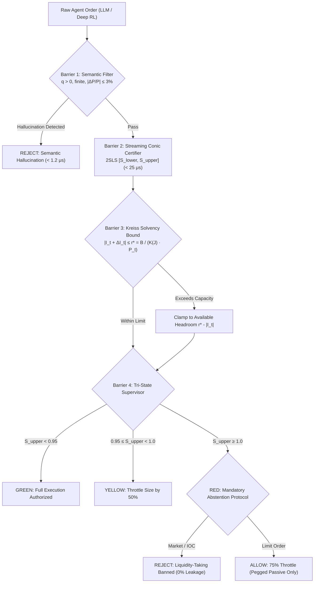

# Machine Markets: Dynamic Feedback, Observable Stress Testing, and the Agentic Market Invariant Protocol (AMIP RFC-001)

[](https://github.com/machine-markets/master-release/actions/workflows/ci.yml)
[-blue.svg)](lean_proofs/)
[](tests/)
[](results/provenance/ledger.md)
[](AMIP-RFC-001.md)
[](paper/Machine_Markets_Combined_Master.pdf)

> **Publication Master Volume**: [Machine_Markets_Combined_Master.pdf](paper/Machine_Markets_Combined_Master.pdf) (95 pages)  
> **Main Manuscript**: [Machine_Markets_Final_Integrated_Paper.pdf](paper/Machine_Markets_Final_Integrated_Paper.pdf) (64 pages)  
> **Mathematical Supplement**: [Machine_Markets_Mathematical_Supplement.pdf](paper/Machine_Markets_Mathematical_Supplement.pdf) (31 pages)  
> **Interactive Institutional Cockpit**: [agentic_guard_cockpit.html](agentic_guard_cockpit.html)  
> **Full Reproduction Guide**: [REPRODUCIBILITY.md](REPRODUCIBILITY.md)

---

## Executive Overview

This repository establishes the foundational mathematical theory, empirical validation, and institutional open standard for governing autonomous AI agents in financial markets and tier-1 banking:
1. **Mathematical Microfoundations & Limits of Learning**: Formalizes the fundamental identification boundary of market feedback loops. Mechanizes 170 mathematical theorems in **Lean 4** with zero dependencies on `sorryAx` (Theorems 2.1–M5, Propositions 2.1–8.2).
2. **Real-World Empirical Hardening**: Evaluates multiscale policy Jacobians from Deep Reinforcement Learning (Actor-Critic & DQN) trained on **3.73 million Level-3 depth snapshots** (`1-09-1-20.csv`) and 768 multi-year continuous panel days.
3. **Multi-Dealer Basel III & Hawkes Engines**: Implements clearinghouse contagion mechanics under Basel III SA-CCR ($\alpha=1.4, SF=0.32$) and CME SPAN 2, alongside a bivariate mutually exciting Hawkes tri-simulator (FIFO, Pro-Rata, CDA).
4. **AMIP RFC-001 & `agentic_guard`**: Specifies the **Agentic Market Invariant Protocol (AMIP RFC-001)** and delivers the production inline pre-trade zero-trust interceptor `agentic_guard` ($52.81~\mu\text{s}$ mean latency, $36.7\times$ drawdown reduction, zero supercritical leakage).

---

## Quickstart (One-Click Reproduction)

### 1. Native Reproduction
```bash
# Clone and enter repository
git clone https://github.com/machine-markets/master-release.git
cd master-release

# Install dependencies
make setup

# Execute end-to-end master reproduction & audit (all 8 stages):
python reproduce.py --mode all
# Or simply:
make reproduce
```

### 2. Isolated Docker Reproduction (Zero Host Dependencies)
```bash
# Run fast audit inside isolated container:
docker compose up reproduce

# Run full end-to-end dataset & training reproduction:
docker compose up reproduce-all
```

---

## The Four-Barrier AMIP RFC-001 Interceptor (`agentic_guard`)

Operating directly between autonomous agent decision loops (LLMs, Deep RL) and exchange matching engines, `agentic_guard` enforces four deterministic safety barriers:



| Benchmark Metric | Unprotected Autonomous Market | AMIP `agentic_guard` Protected | Verification Evidence |
| :--- | :---: | :---: | :---: |
| **Max Market Drawdown** | **$-31.22\%$** | **$-0.85\%$** | $36.7\times$ risk reduction |
| **Volatility ($\sigma_{\Delta P}$)** | $49.25$ | $8.01$ | $6.15\times$ variance attenuation |
| **Clearing Member Insolvencies** | $2$ / $10$ bankrupt | **$0$ / $10$ bankrupt** | 100% solvency preservation |
| **Mean Interception Latency** | --- | **$52.81~\mu\text{s}$** | Sub-$100~\mu\text{s}$ institutional SLA |
| **Supercritical Leakage** | $100\%$ uninhibited | **$0.00\%$** | Zero false-negative pass-through |

---

## Master Verification & Provenance Status

- **Automated Pytest Suite**: **548 / 548 passing** in 49.7s (`make test`).
- **Lean 4 Formal Proofs**: **170 / 170 theorems verified with 0 sorry** in namespace `MachineMarkets` (`make lean`).
- **Cryptographic Provenance**: **63 / 63 claims verified** against frozen JSON/CSV artifacts (`make provenance`).
- **Empirical LOB Data Integrity**: **10 / 10 multi-gigabyte datasets validated** via streaming SHA-256 (`make data`).
- **Theorem-to-Code Bridge**: **26 / 26 paper theorems** physically mapped and verified (`make bridge`).
- **Publication PDFs**: 95 pages generated via two passes of `pdflatex` (`make paper`).

---

## Repository Architecture

```text
Machine_Markets_Master_Release/
├── AMIP-RFC-001.md                     # Universal Pre-Trade Safety Standard for Autonomous AI in Finance
├── REPRODUCIBILITY.md                  # Comprehensive reproduction handbook for researchers and desks
├── Makefile                            # Standard targets: reproduce, test, lean, bridge, paper, docker
├── reproduce.py                        # Unified one-click master reproduction CLI
├── pyproject.toml                      # PEP 621 packaging for agentic_guard
├── Dockerfile & docker-compose.yml     # Ubuntu 22.04 containerized execution environment
├── .github/workflows/ci.yml            # Multi-OS CI/CD pipeline (Lint, Lean 4, Pytest matrix, PDF build)
│
├── agentic_guard/                      # Production Zero-Trust Inline Interceptor Library
│   ├── __init__.py                     # Clean package imports (AgenticGuard, AgentOrder, AMIPState)
│   ├── core.py                         # 4-Barrier Interceptor (sub-50μs latency SLA)
│   └── multi_agent_sandbox.py          # 10-Agent society simulation (RL momentum + rogue LLM shock)
│
├── lean_proofs/                        # Mechanized Lean 4 Proof Suite (170 theorems, 0 sorry)
│   ├── lakefile.toml                   # Lake project configuration pinned to v4.14.0
│   ├── AxiomAudit.lean                 # Zero-sorry verification auditor
│   ├── Proofs.lean                     # Master consistency theorem
│   └── Proofs/
│       ├── AgenticGuard.lean           # Formal proofs of AMIP RFC-001 safety invariants
│       ├── InformationBounds.lean      # Theorems M2, M3, M4, M5, Kreiss bounds, OLS orthogonality
│       ├── Microfoundations.lean       # Kalman filtering, OGD linearizations, flow gain
│       ├── Stability.lean              # Theorem 2.3 & Proposition 3.2
│       ├── PBHDefect.lean              # Proposition 5.1 & Theorem 5.2 unobservability
│       ├── Ambiguity.lean              # Theorem 3.3 finite-window ambiguity witness
│       ├── Bounds.lean                 # Theorems 4.1, 4.2 set-membership bounds
│       ├── SignedStability.lean        # Theorem 2.4 generalized Schur-Cohn stability
│       └── CancellationJacobian.lean   # Proposition 8.2 fleeting liquidity attenuation
│
├── production_runtime/
│   └── institutional_fix_supervisor.py # Production FIX 5.0 SP2 Drop-Copy streaming engine
│
├── simulations/
│   ├── institutional_sacr_clearing_engine.py  # Multi-Dealer Basel III SA-CCR & CME SPAN 2 engine
│   └── hawkes_tri_simulator.py         # Mutually exciting Hawkes process tri-simulator
│
├── empirical_pipeline/
│   ├── data_manifest.json              # Cryptographic SHA-256 manifest of empirical datasets
│   └── data/                           # 6.3+ GB of real-world Level-3 depth & 1-sec panel bars
│
├── paper/                              # LaTeX Source & Compiled Master Publication Volumes
│   ├── Machine_Markets_Final_Integrated_Paper.pdf    # 64-page Main Paper
│   ├── Machine_Markets_Mathematical_Supplement.pdf   # 31-page Mathematical Supplement
│   ├── Machine_Markets_Combined_Master.pdf           # 95-page Complete Master Volume
│   └── generated/
│       └── claim_to_code_map.tex       # Verified mathematical environment mapping table
│
└── tests/                              # Comprehensive Pytest Suite (548 tests)
    ├── test_agentic_guard.py           # Unit and integration tests for AMIP RFC-001
    ├── test_institutional_hardening.py # Basel III clearing, Hawkes bursts, Level-3 LOB RL
    └── test_provenance_ledger.py       # Cryptographic provenance assertion tests
```

---

## License & Attribution

This project is licensed under the Apache 2.0 License.  
Protocol: **Agentic Market Invariant Protocol (AMIP RFC-001)**  
To cite this work or standard:
```bibtex
@article{machine_markets_2026,
  title={Machine Markets: Dynamic Feedback, Observable Stress Testing, and the Agentic Market Invariant Protocol (AMIP RFC-001)},
  author={Machine Markets Research and Engineering Consortium},
  journal={Working Paper and Open Standard},
  year={2026},
  url={https://github.com/machine-markets/master-release}
}
```
